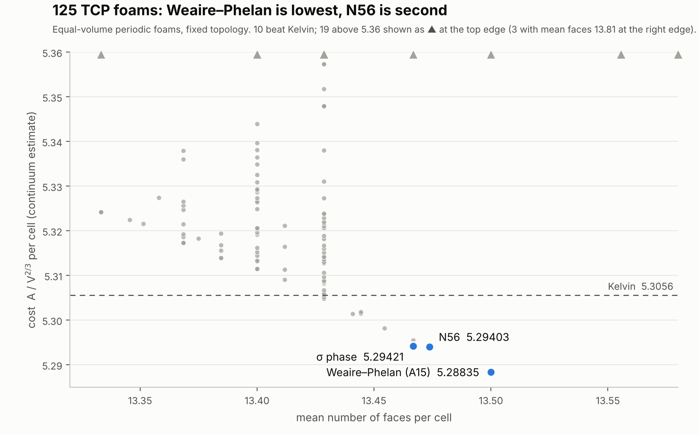

# Equal-volume foam costs of all enumerated TCP structures

**Short version.** We computed the minimal surface area of equal-volume periodic foams (the Kelvin problem)
for every tetrahedrally close-packed (TCP) structure enumerated by Dutour Sikirić, Delgado-Friedrichs and Deza
(2010) and Dutour Sikirić and Deza (2012), plus nine alloy structures: 125 distinct topologies in all. Weaire–Phelan (A15) stays the lowest.
In second place is **N56**, an enumerated structure with no known alloy counterpart. Its cost is **5.29400**, about
**0.00019 (0.0036 %) below the σ phase (5.29419)**, which has been the runner-up in the literature. Two independent
programs give the same order at every mesh resolution: our own Python relaxer and Surface Evolver 2.70.

This repository holds everything needed to check or dispute the result. **If you find an error, or an earlier
computation of N56, please [open an issue](../../issues/new/choose).**

**New in v1.3** (details in [REPORT.md §11](REPORT.md#11-additions-in-v13)):
- The M phase (Nb–Ni–Al, sites from Shoemaker & Shoemaker 1967): 5.31471, a new topology. 131 topologies.
- WP 2×1×1 enumerated to five T1 moves (1,017,431 states at depth 4): nothing below WP.
- T2-type moves (one cell inserted or deleted, then T1 rearrangement): an inserted cell costs about +0.78.

**New in v1.2** (details in [REPORT.md §10](REPORT.md#10-additions-in-v12)):
- The R and P phases from crystal structures (COD). **P** (56 cells, 5.30397) is the lowest structure with its
  mean face count and 12th overall; R is above Kelvin. 130 topologies, 14 beat Kelvin.
- An exhaustive T1 enumeration with a finer duplicate test: WP is lower than every triangle-free topology within
  five T1 moves (8-cell cell), four (16-cell) and three (32-cell); σ within three.

**New in v1.1** (details in [REPORT.md §9](REPORT.md#9-additions-in-v11)):
- Three more TCP structures from the same dataset, the Shoemaker F, J and K phases. **K** (82 cells, 5.29525) is
  now fourth, after WP, N56 and σ.
- A search over **non-TCP topologies** reached by T1 moves (Pachner flips on the dual triangulation; 3-, 4- and
  7-gon faces allowed) from WP, σ and N56. Nothing lower than the starting structure was found. Topologies whose
  new triangular face collapses under relaxation are not stable foams; extrapolating them gives spurious values.
- Across all 128 topologies, cost against mean faces per cell has a lower convex hull with only three vertices:
  C15 family, σ and A15.

한국어 요약: [README.ko.md](README.ko.md)

## Main result

Cost = cell surface area / V^(2/3) (dimensionless, per cell; lower is better), extrapolated to the continuum limit.

| Structure | Cells / unit cell | Own relaxer (r = 2, 3, 4 fit) | Surface Evolver 2.70 (levels 2, 3) | Literature |
|---|---|---|---|---|
| Weaire–Phelan (A15) | 8 | 5.288345 | 5.288339 | 5.28834 [Reddy et al. 2018] |
| **N56** | 76 | **5.294032** | **5.294000** | not found |
| σ phase | 30 | 5.294214 | 5.294193 | 5.29423 [Phelan, as quoted by Reddy et al.] |

N56 − σ at each resolution: own relaxer −0.00011, −0.00017, −0.00017, −0.00018 (r = 1…4).
Surface Evolver −0.00014, −0.00018, −0.00019, −0.00019 (levels 0…3).

**N56**: space group I4₁/amd, 76 cells per conventional cell (24 Z12, 44 Z14, 8 Z15), mean 13.474 faces per cell.
Source file: `data/source_cgd/N56.cgd`, taken from the Zenodo dataset of Dutour Sikirić et al.

## Catalogue of TCP foams (125 in v1.0, 128 in v1.1, 130 in v1.2, 131 in v1.3)

- Only **14** of the 131 distinct TCP topologies (10 of the original 125) beat Kelvin's foam (5.3056).
- No enumerated TCP structure with ≤ 21 cells per fundamental domain beats Weaire–Phelan.
- Cost tends to fall as the mean number of faces approaches 13.5, where A15 sits. Structures with more than
  13.5 faces per cell are much worse.
- Polytypes built from the same layers have almost the same cost. For example, the Laves phases C14, C15 and C36
  all fall in 5.32421–5.32423.

Full table: [`data/tcp_foam_catalog.csv`](data/tcp_foam_catalog.csv). It has space group, cell composition, cost at
r = 2, 3, 4, the extrapolated value and notes for each structure. The detailed write-up is in
[REPORT.md](REPORT.md).

## How to check or challenge this

| You want to… | Do this |
|---|---|
| Re-run the headline numbers | `python code/rigor.py` (r = 4 runs take about 1 h for N56 on 10 cores) |
| Re-run with Surface Evolver | `evolver -f surface_evolver/run.cmd surface_evolver/n56.fe` |
| Re-run the whole catalogue | `python code/catalog.py 10` (about 6–8 h on 10 cores) |
| Check that cells tile space | `python code/space_filling_check.py n20:N56` |
| Re-run the T1 searches (v1.1) | `python code/t1search.py alloy:Cr3Si_A15 2x1x1 6 8 10`, `python code/t1_stable.py n20:Phys26 1x1x1 3 10` |
| Re-run F, J, K (v1.1) | `python code/shoemaker_build.py && python code/shoemaker_run.py 2` |
| Re-run R, P (v1.2) | `python code/cif_build.py && python code/shoemaker_run.py 2 data/tcp_cif.json rerun/cif_phases.jsonl` |
| Re-run the exhaustive T1 enumeration (v1.2) | `python code/t1_deep.py alloy:Cr3Si_A15 1x1x1 5 10` |
| Re-run the T2-type probe (v1.3) | `python code/t2_probe.py alloy:Cr3Si_A15 2x1x1 10` |
| Report an error or prior work | [Open an issue](../../issues/new/choose); see [CONTRIBUTING.md](CONTRIBUTING.md) |

Reruns write to `rerun/`, so the archived results in `results/` are never overwritten.
Requirements: Python ≥ 3.10, numpy, scipy (`pip install -r requirements.txt`). `gemmi` is only needed to
regenerate `data/tcp_all.json` from `.cgd` files.

## Method in one paragraph

Each structure's cell centres, space group and neighbour list are read from the `.cgd` files and expanded by
symmetry. A flat foam is then built directly from the neighbour graph: one vertex per tetrahedron of mutually
adjacent cells, one face per pair of neighbours. The films are triangulated (level r, triangles ∝ r²). Total area
is minimised with every cell volume fixed to 1, using an augmented Lagrangian with L-BFGS, and the 9 components of
the unit cell are relaxed too. For the top structures, Surface Evolver 2.70 independently refines and minimises the
same topologies. Checks include r = 1–4 convergence, a power-diagram start, random perturbation and re-relaxation,
120° Plateau angles, volume error < 1e-6, and a winding-number test that cells fill space exactly once.
Details and caveats: [REPORT.md](REPORT.md).

## Known limitations

- Catalogue values are for **fixed topology** (T1 neighbours of WP, σ, N56 are tested in REPORT §9.2). High-cost structures (above about 5.40) are genuine space-filling
  partitions, but they are probably unstable to T1 changes.
- In Surface Evolver the unit cell was fixed at the shape found by our relaxer. Every level hit the 80-round
  iteration cap, so those values are slight upper bounds.
- The σ and N56 Surface Evolver runs started from the graph-built flat foam. The WP run started from an
  equal-volume power diagram.
- "Not found in the literature" means published work we could check. We could not check unpublished data.
- The difference from σ is small (0.0036 %). This does not bear on whether Weaire–Phelan is optimal.

## Provenance and AI use

The code and computations were produced with the help of an AI assistant (Anthropic's Claude), working under the
direction of the author. The author is responsible for the content. All numbers in this repository come from the
code here and can be reproduced with it.

## License and attribution

- Code (`code/`): MIT, see [LICENSE](LICENSE).
- Data, results, figures and text: CC BY 4.0, see [LICENSE-DATA.md](LICENSE-DATA.md).
- The structure topologies come from M. Dutour Sikirić (2024),
  *Dataset and programs for the work on space-fullerenes*, Zenodo 13691342, CC BY 4.0. The files in
  `data/source_cgd/` and the derived `data/tcp_all.json` are adapted from that dataset.
- `data/source_cif/` holds crystal structures from the [Crystallography Open Database](https://www.crystallography.net/)
  (COD 2310299, 2310312, 2311049; original data from IUCr Journals, see the references in each file), and the
  M-phase sites transcribed from Shoemaker & Shoemaker, Acta Cryst. 23 (1967) 231, Table 2.

## Citation

Hyukdong Kim, *Equal-volume foam costs of all enumerated TCP structures, and the N56 foam*, Zenodo (2026). v1.2.0:
doi:[10.5281/zenodo.24082492](https://doi.org/10.5281/zenodo.24082492)
(v1.1.0: doi:[10.5281/zenodo.24080149](https://doi.org/10.5281/zenodo.24080149); v1.0.0: doi:[10.5281/zenodo.24053853](https://doi.org/10.5281/zenodo.24053853)).
To cite all versions (always resolves to the latest), use doi:[10.5281/zenodo.24053852](https://doi.org/10.5281/zenodo.24053852).
Also see [CITATION.cff](CITATION.cff).

## References

- M. Dutour Sikirić, O. Delgado-Friedrichs, M. Deza, *Space fullerenes: a computer search for new Frank–Kasper
  structures*, Acta Cryst. A 66, 602–615 (2010), doi:10.1107/S0108767310022932. [link](https://openresearch-repository.anu.edu.au/items/1108fa8d-b7a9-4af1-aff2-b9fffbee1c6c/full)
- M. Dutour Sikirić, M. Deza, *Space fullerenes: computer search for new Frank–Kasper structures II*,
  Struct. Chem. 23, 1103–1114 (2012), doi:10.1007/s11224-012-0005-3. [link](https://link.springer.com/article/10.1007/s11224-012-0005-3)
- Dataset: [Zenodo 13691342](https://zenodo.org/records/13691342)
- A. Reddy et al., *Stable Frank–Kasper phases of self-assembled, soft matter spheres*, PNAS 115 (2018).
  [arXiv:1806.01726](https://arxiv.org/abs/1806.01726)
- D. Weaire, R. Phelan, *A counter-example to Kelvin's conjecture on minimal surfaces*,
  Phil. Mag. Lett. 69 (1994) 107.
- R. Phelan, D. Weaire, K. Brakke, *Computation of equilibrium foam structures using the Surface Evolver*,
  Exp. Math. 4 (1995). [link](https://projecteuclid.org/journals/experimental-mathematics/volume-4/issue-3/Computation-of-equilibrium-foam-structures-using-the-surface-evolver/em/1062621077.full)
- S. J. Cox, F. Graner, R. Mosseri, J.-F. Sadoc, *Quasicrystalline three-dimensional foams*,
  J. Phys.: Condens. Matter 29 (2017), doi:10.1088/1361-648X/aa5712. [arXiv:1610.09286](https://arxiv.org/abs/1610.09286)
- K. Brakke, *Surface Evolver*. [link](https://kenbrakke.com/evolver/evolver.html)
